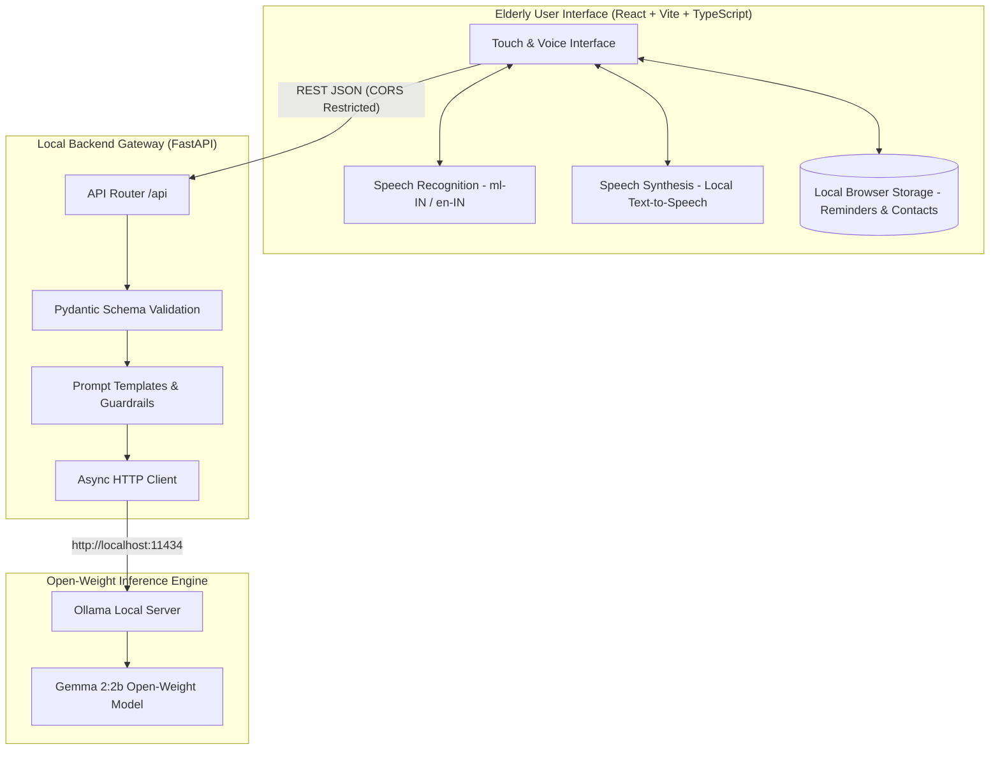

# Sahaaya AI (സഹായ AI)

> **Tagline:** A little help, a more independent life.  
> **Challenge:** Hacktoberfest 2026 DEV Challenge — Week 3: *“Slow and Steady”*  
> **Tags:** `#devchallenge` `#hf26challenge`

---

## 1. Project Overview

**Sahaaya AI** is a Malayalam-friendly, voice-first digital companion designed with care for older adults. By pairing local-first privacy with open-weight AI inference (Google's Gemma open models via Ollama), Sahaaya AI helps seniors live independently without the confusion of complex smartphone interfaces, cloud trackers, or aggressive notification spam.

Sahaaya AI solves three everyday hurdles for elderly users:
1. **Never forget daily essentials:** Voice-driven and manually configured reminders for medicines, clinic visits, and calls with family.
2. **Understand confusing messages:** An AI assistant that deciphers confusing hospital notices, bank SMS, and government letters into simple language while flagging suspicious requests for passwords, OTPs, or urgent payments.
3. **One-tap connection to loved ones:** Reassuring, large-target call buttons and pre-composed help messages that connect users to their trusted family contacts without searching through contacts books.

---

## 2. Problem Statement

Modern mobile applications are designed for speed and information density: tiny typography, multi-level dropdowns, hidden hamburger menus, and fast-paced animations. For older adults—especially those whose primary language is Malayalam and who face age-related visual or cognitive fatigue—digital technology often feels alienating and stressful.

Furthermore, elderly people are disproportionately targeted by deceptive financial and OTP phishing scams sent via SMS. Typical commercial chatbots send private health and message data to remote cloud servers. Sahaaya AI brings compassionate accessibility and open-weight AI directly to local hardware, ensuring all reminders, family contacts, and message transcripts remain private and under user control.

---

## 3. Architecture & Data Flow

Sahaaya AI follows a **Local-First Architecture**. User data (reminders, contacts, preferences) is persisted directly in browser storage (`localStorage` / IndexedDB). AI requests (reminder intent interpretation and message explanation) are processed by a local Python FastAPI gateway communicating with an open-weight Gemma model hosted locally through Ollama.



---

## 4. Key Features

### A. Welcoming Setup (No Accounts Required)
- **Zero Registration:** No passwords, phone verification, or third-party sign-ins.
- **Language Selection:** Instant choice between **മലയാളം (Malayalam)** and **English**.
- **Clear Permissions:** Transparent explanation of microphone usage and notifications; permissions are never requested on initial page load.

### B. High-Accessibility Design System
- **Touch-Friendly Controls:** All primary interactive elements exceed 48×48px touch target requirements.
- **Warm & Reassuring Palette:** Soft off-white backgrounds (`#FBF9F5`), gentle sage green accents (`#2D6A4F`), and high-contrast charcoal text (`#1E2D24`).
- **Dynamic Text Scaling:** One-tap toggle between **Normal (18px)**, **Large (20px)**, and **Extra Large (22px)** with clean Malayalam font rendering (`Noto Sans Malayalam`, `Manjari`).
- **Dual Visual Status:** Status is never communicated using color alone; distinct semantic icons and text badges accompany every state.

### C. Voice-First Digital Assistant
- Speak instructions in Malayalam or English (e.g., *"രാത്രി എട്ട് മണിക്ക് ഗുളിക കഴിക്കാൻ ഓർമ്മിപ്പിക്കുക"* or *"Remind me to call my daughter at six this evening"*).
- Visual microphone indicator with real-time editable transcription review.
- Model interprets requests into structured schemas (`create_reminder`, `clarification_needed`, `explain_message`).
- **Mandatory Human Confirmation:** Sahaaya never schedules a reminder without explicit user confirmation on a summary card.
- **Ambiguity Guard:** If the requested time or date is missing, Sahaaya asks a gentle clarifying question instead of guessing.

### D. Daily Reminder Management
- Persisted locally across page refreshes.
- Chronological ordering highlighting **Due Today**, **Upcoming**, and **Overdue** items.
- Gentle audible chime (synthesized via Web Audio API sine waves, requiring no external media files) and top-banner alert when a reminder is due.
- Safe two-step deletion confirmation.

### E. "Help Me Understand" (Message Explainer)
- Paste confusing SMS, hospital discharge notes, or official notices.
- Produces a 4-part breakdown:
  1. **In Simple Words (ലളിതമായി പറഞ്ഞാൽ):** Clear, jargon-free summary.
  2. **Important Details (പ്രധാന വിവരങ്ങൾ):** Dates, times, and contact numbers extracted verbatim.
  3. **What You May Need To Do (നിങ്ങൾ ചെയ്യേണ്ടത്):** Step-by-step actionable advice.
  4. **Things to Check & Safety Warnings (ശ്രദ്ധിക്കേണ്ട കാര്യങ്ങൾ):** Proactive scam warning if OTPs, banking PINs, or urgent wire transfers are mentioned.
- Medical and banking disclaimer reminding users to confirm directly with their healthcare professional or bank branch.

### F. Trusted Family Contacts
- Dedicated cards for trusted loved ones with prominent, one-tap calling (`tel:` protocol).
- Pre-composed assistance messages reviewable before launching the native SMS application.

---

## 5. Why Open-Weight AI Matters

Sahaaya AI deliberately leverages **open-weight models** (such as Google Gemma 2:2b) running locally via Ollama:
- **Absolute Privacy:** Vulnerable health notifications, prescription notes, and personal family conversations are never transmitted to third-party cloud aggregators or used to train advertising models.
- **Offline Resilience:** Once downloaded, core intent parsing and reasoning function completely on-device without continuous internet access.
- **Hardware Accessibility:** Gemma 2:2b has a compact memory footprint (~1.6 GB VRAM/RAM), allowing it to run smoothly on standard laptops and modest home desktops without expensive enterprise GPUs.
- **Adaptability:** Developers can customize prompt parameters, add domain vocabularies, or fine-tune models to local dialects without vendor lock-in or subscription API fees.

---

## 6. Technology Stack

| Layer | Technologies |
| :--- | :--- |
| **Frontend** | React 18, Vite, TypeScript |
| **Styling** | Tailwind CSS (Custom accessibility tokens & font scales) |
| **Icons** | Lucide React |
| **Backend** | Python 3.13, FastAPI, Uvicorn, Pydantic v2 |
| **HTTP & AI Client** | HTTPX (Async) |
| **Local AI Engine** | Ollama with `gemma2:2b` open-weight model |
| **Speech APIs** | Web Speech API (`SpeechRecognition` & `SpeechSynthesis`) |
| **Testing** | Vitest, React Testing Library, Pytest, Pytest-Asyncio |

---

## 7. Windows Local Setup Guide

### Prerequisites
- **Node.js**: v18+ (Tested on Node v24)
- **Python**: 3.10+ (Tested on Python 3.13)
- **Ollama**: (Optional for full AI reasoning, app runs in graceful degraded mode when offline)

### Step 1: Clone the Repository
```powershell
cd C:\Users\OWNER\OneDrive\Desktop\test
```

### Step 2: Set up the Python Backend
```powershell
# Create virtual environment
python -m venv .venv

# Activate virtual environment
.\.venv\Scripts\Activate.ps1

# Install dependencies
pip install -r backend\requirements.txt

# Start backend server
uvicorn app.main:app --app-dir backend --reload --port 8000
```
Backend API docs will be accessible at: `http://localhost:8000/docs`  
Health status endpoint: `http://localhost:8000/api/health`

### Step 3: Set up the React Frontend
In a new terminal window:
```powershell
# Install frontend dependencies
npm install

# Start development server
npm run dev
```
Open your browser at `http://localhost:5173`.

---

## 8. Ollama & Open-Weight Model Setup

To enable genuine local AI inference:

1. **Install Ollama:** Download the Windows installer from [ollama.com](https://ollama.com).
2. **Start Ollama:** Open PowerShell and run:
   ```powershell
   ollama serve
   ```
3. **Pull the Gemma 2:2b open-weight model:**
   ```powershell
   ollama run gemma2:2b
   ```
4. **Hardware Requirements:**
   - RAM: Minimum 4 GB available system RAM.
   - Storage: ~1.6 GB for the model weights.
   - GPU: Optional (Ollama automatically utilizes CPU if no dedicated GPU is available).

*Note: If Ollama is not running, Sahaaya AI continues to function in graceful offline mode with non-AI features (manual reminder creation, completing reminders, and trusted contacts management) remaining 100% operational.*

---

## 9. Running the Test Suite

Both backend and frontend feature thorough automated test suites covering input validation, error handling, mock AI inference, and user workflows.

### Run Backend Pytest Suite
```powershell
.\.venv\Scripts\pytest backend\tests -v
```
*Result: 8/8 tests pass (100% pass rate).*

### Run Frontend Vitest Suite
```powershell
npm test
```
*Result: 19/19 tests pass across 6 test files.*

### Build Frontend Production Bundle
```powershell
npm run build
```
*Result: Clean TypeScript compilation and Vite bundling.*

---

## 10. Walkthrough & Demo Script

Follow this script to verify the core user journey:

1. **Onboarding:**
   - Launch `http://localhost:5173`.
   - Choose language: Select **മലയാളം** or **English**.
   - Enter your preferred name (e.g., *"Grandma Radha"*).
   - Tap **Get Started**.
2. **Reviewing the Dashboard:**
   - Notice the time-based greeting (*"Good morning, Grandma Radha!"*).
   - Observe the current date and empty reminder notice.
3. **Creating a Reminder by Voice or Text:**
   - Tap **Talk to Sahaaya**.
   - Either tap the large green microphone or type into the input field:  
     `"Remind me to take my blood pressure medicine at 8 tonight"`
   - Tap **Ask Sahaaya**.
   - Observe the confirmation card detailing title (`Blood pressure medicine`), date (`Today`), and time (`20:00`).
   - Tap **Yes, Save Reminder**.
   - Return to Home: the reminder is now displayed under *"What to remember today"*.
4. **Deciphering a Confusing Message:**
   - Tap **Help Me Understand** on the bottom navigation.
   - Tap the sample button **"Suspicious Bank SMS"**.
   - Tap **Explain in Simple Words**.
   - Notice the prominent red **Security Warning** alerting that OTPs should never be shared, accompanied by an accessible plain-language breakdown.
5. **Calling a Family Member:**
   - Tap **Family Contacts** on the bottom navigation.
   - View your trusted contact (e.g., *Lakshmi - Daughter*).
   - Tap **Call Now** to trigger the phone dialer, or tap **Send Help Message** to review a polite, prepared SMS.

---

## 11. Known Limitations & Future Work

- **Browser Speech Recognition in Regional Languages:** Native browser `webkitSpeechRecognition` for Malayalam (`ml-IN`) depends on operating-system speech engine support. Where unsupported by the browser, Sahaaya provides text input and transcription editing as a seamless fallback. Future iterations can integrate an on-device Whisper model via WebAssembly.
- **Background Push Notifications:** Browser notifications when the tab is completely closed require service worker background sync permissions. Currently, Sahaaya emphasizes reliable in-app visual and audio alerts while the application is open.
- **Dialect Adaptation:** While Gemma 2:2b handles standard Malayalam and English well, colloquial regional Malayalam idioms can be improved in future releases using LoRA fine-tuning with open community datasets.

---

## 12. License

This project is licensed under the MIT License. Open-weight Gemma models are distributed under the Gemma Terms of Use.
