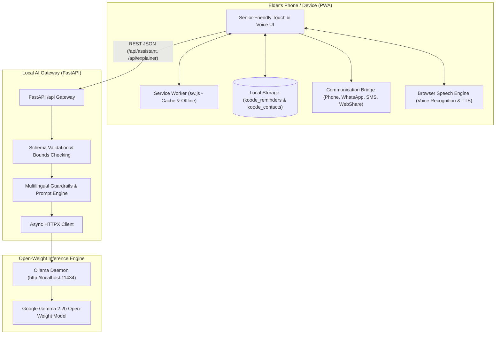

# Koode AI (കൂടെ AI)

> **Tagline:** Always by your side • എന്നും നിങ്ങളുടെ കൂടെ  
> **Challenge:** Hacktoberfest 2026 DEV Challenge — Week 3: *“Slow and Steady”*  
> **Tags:** `#devchallenge` `#hf26challenge`

---

## 1. Project Overview & Name Origin

**Koode AI** (**കൂടെ AI**) is a compassionate, voice-first companion designed from the ground up for older adults. In Malayalam, the word *"Koode"* (കൂടെ) means *"By your side"* or *"With you"*—reflecting our belief that technology for elders should never feel like a clinical medical device or a confusing corporate portal; it should feel like a patient, loving companion always sitting beside you.

Built for the **Hacktoberfest 2026 DEV Challenge — Week 3 ("Slow and Steady")**, Koode AI combines **local-first privacy** with open-weight AI inference (**Google Gemma 2:2b** via **Ollama**). It helps seniors maintain their autonomy and peace of mind without passwords, cloud data trackers, aggressive notification spam, or tricky multi-step navigation.

### The 4 Pillars of Koode AI
1. **Never forget daily essentials:** Voice-first or 1-tap scheduling for medicines (💊), clinic appointments (🩺), family calls (📞), and hydration (💧), backed by clear confirmation timestamps (*"✓ Done today at 8:15 PM"*).
2. **Understand confusing messages & stay safe:** An AI-powered plain-language interpreter that deciphers confusing hospital discharge instructions, utility notices, and bank SMS, with proactive warnings against financial scams, fake OTP requests, and urgent payment schemes.
3. **Real, working communication (Call, WhatsApp, SMS, SOS):** Direct phone dialer triggers (`tel:`), instant WhatsApp chat integration, pre-composed SMS assistance messages, and an unmissable 1-tap **Emergency SOS** distress broadcast.
4. **Installable phone application (PWA):** Installs cleanly onto Android or iPhone home screens with a single tap, providing a native full-screen app experience, standalone status bar, and offline service worker caching.

---

## 2. Senior Ergonomics & Accessible Design System

Older adults face physical and sensory realities that mainstream software frequently ignores: presbyopia (diminished close-up visual acuity), tremors or reduced motor precision, arthritis, slower cognitive processing, and anxiety about pressing the "wrong button".

Koode AI was engineered with senior human-computer interaction (HCI) best practices:

| Elder Need | Senior UX Solution in Koode AI |
| :--- | :--- |
| **Reduced Fine Motor Control & Tremors** | Huge touch targets (minimum 52–64px), generous margins between interactive controls, and zero tiny icon-only links without accessible descriptions. |
| **Presbyopia & Aging Vision** | 3-stage dynamic text scaling (Normal 18px, Large 20px, Extra Large 22px), high WCAG 2.2 AA contrast with dark forest greens and cream backgrounds (`#FBF9F5`), and custom Malayalam script kerning (`Noto Sans Malayalam`). |
| **Cognitive Memory Load & Anxiety** | Explicit confirmation dialogs before saving or deleting; immediate reassuring state feedback (*"✓ Done at 8:15 PM"*) so elders never worry if they already took their pill. |
| **Tactile & Auditory Reassurance** | Subtle haptic vibrations (`navigator.vibrate`) on key button presses, and gentle sine-wave chime notifications synthesized through the Web Audio API without bulky audio assets. |
| **Multi-Channel Communication** | Direct Phone Calling, WhatsApp Web/App messaging, native SMS, and Web Share API. Older adults can choose whichever medium their family uses most. |

---

## 3. Global Multilingual Interface

Koode AI offers complete, native localization across **10 global languages**:
- **English** (`en`)
- **മലയാളം — Malayalam** (`ml`)
- **Español — Spanish** (`es`)
- **Français — French** (`fr`)
- **Deutsch — German** (`de`)
- **Português — Portuguese** (`pt`)
- **Italiano — Italian** (`it`)
- **العربية — Arabic** (`ar` - with RTL support)
- **中文 — Chinese** (`zh`)
- **日本語 — Japanese** (`ja`)

Every screen, modal, error notice, and voice response adapts seamlessly to the elder's preferred language.

---

## 4. Architecture & Data Flow

Koode AI follows a **Local-First, Privacy-Centric Architecture**. Sensitive health information, medication schedules, and family phone numbers are kept strictly on the user's device (`localStorage` / IndexedDB).



---

## 5. Mobile Phone Installation (PWA)

Koode AI is a fully compliant **Progressive Web App (PWA)**:
- **Web App Manifest (`public/manifest.webmanifest`):** Configured with `display: "standalone"`, orientation `portrait`, and theme color `#2D6A4F`.
- **Service Worker (`public/sw.js`):** Intercepts static assets, fonts, and scripts, serving them from cache for instant offline startup.
- **In-App Install Banner:** Automatically detects when the browser supports installation and presents a warm, friendly card inviting the user to install Koode to their home screen.
- **iOS Safari Support:** Clear instructions guiding iPhone users to tap *Share ⎙* and select *Add to Home Screen*.

---

## 6. Real Communication Features

Elders need instant, friction-free ways to reach their loved ones:

### 1. Emergency SOS Alert
- **High-Visibility Red Banner:** Accessible right at the top of the Home Dashboard.
- **2-Stage Safety Trigger:** Prevents accidental pocket triggers with an unmistakable confirmation dialog showing the trusted contact's name and number.
- **Haptic Feedback:** Vibrates with an SOS pattern (`[150, 80, 150]`).
- **Dual Action:** Automatically initiates a direct phone call and queues an urgent distress message via WhatsApp/SMS:  
  *`"EMERGENCY: [Grandma Radha] I need immediate assistance! Please call me right away."`*

### 2. One-Tap Phone Calling (`tel:`)
- Dials family members instantly without navigating confusing smartphone dialers.

### 3. WhatsApp Integration (`wa.me`)
- Opens WhatsApp with a polite, pre-composed greeting:  
  *`"നമസ്കാരം ലക്ഷ്മി, എനിക്ക് ഒരു ചെറിയ സഹായം വേണമായിരുന്നു. സൗകര്യപ്പെടുമ്പോൾ എന്നെ ഒന്ന് തിരിച്ചുവിളിക്കാമോ?"`*  
  *(Hello Lakshmi, I need a little help. Could you please call me when you have a moment?)*

### 4. Native SMS & Web Share API
- Launches the native messaging app with prepared messages formatted for both iOS and Android.

---

## 7. Technology Stack

| Layer | Technologies |
| :--- | :--- |
| **Frontend** | React 18, Vite, TypeScript, Tailwind CSS, Lucide Icons |
| **Mobile / PWA** | Web App Manifest, Service Worker (`sw.js`), Web Audio API, Web Speech API, Web Share API |
| **Backend** | Python 3.13, FastAPI, Uvicorn, Pydantic v2, HTTPX |
| **Open-Weight AI** | Google Gemma 2:2b running on Ollama |
| **Testing** | Vitest, React Testing Library, Pytest, Pytest-Asyncio |

---

## 8. Quickstart & Installation

### Prerequisites
- **Node.js**: v18+ (Tested on v24)
- **Python**: 3.10+ (Tested on 3.13)
- **Ollama**: (Optional for AI reasoning; app runs in 100% operational offline fallback mode without it)

### Step 1: Start the Python Backend
```powershell
# Navigate to project directory
cd C:\Users\OWNER\OneDrive\Desktop\test

# Activate virtual environment
.\.venv\Scripts\Activate.ps1

# Install dependencies (if not already installed)
pip install -r backend\requirements.txt

# Start FastAPI server
uvicorn app.main:app --app-dir backend --reload --port 8000
```
Backend API docs: `http://localhost:8000/docs`  
Health endpoint: `http://localhost:8000/api/health`

### Step 2: Start the React Frontend
In another terminal:
```powershell
# Install frontend dependencies
npm install

# Start Vite dev server
npm run dev
```
Open `http://localhost:5173` in your browser or phone browser.

### Step 3: (Optional) Start Open-Weight Gemma AI
```powershell
# In a terminal window:
ollama run gemma2:2b
```

---

## 9. Verification & Test Suite

Both backend and frontend maintain full automated test coverage:

```powershell
# 1. Run Python Backend Tests
.\.venv\Scripts\pytest backend\tests -v
# Output: 8 passed in 1.43s (100% pass rate)

# 2. Run React Frontend Tests
npm test
# Output: 6 passed (6 test files), 19 passed (19 tests)

# 3. Compile Production Bundle
npm run build
# Output: Clean TypeScript compilation & Vite bundling (Zero errors)
```

---

## 10. License & Acknowledgments

This project is open-source under the MIT License.  
Developed with passion and care for older adults everywhere as part of the **Hacktoberfest 2026 DEV Challenge — Week 3**.
